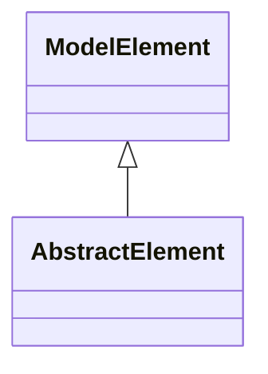

# AbstractElement

Package: [model](./index.md)

The base class of the ROLAP mapping model, itself a CWM objectmodel/core ModelElement. Identity (name), visibility, tagged values, dependencies, constraints and namespace ownership are inherited from ModelElement; documentation lives in businessinformation Descriptions owned by the element's nearest namespace (type 'documentation'); this class adds no own features. Every major schema component (Catalog, Cube, Dimension, Hierarchy, Level, Measure, etc.) inherits from this class, so all of them are CWM ModelElements and can be traversed, tagged and owned with the generic CWM tooling.
## Extends
- ModelElement [🔗](./class-ModelElement)

## Attributes

<table>
  <thead>
    <tr>
      <th>Name</th>
      <th>Id</th>
      <th>Type</th>
      <th>Lower</th>
      <th>Upper</th>
      <th>Default</th>
    </tr>
  </thead>
  <tbody>
  </tbody>
</table>

## References

<table>
  <thead>
    <tr>
      <th>Name</th>
      <th>Type</th>
      <th>Lower</th>
      <th>Upper</th>
      <th>Containment</th>
    </tr>
  </thead>
  <tbody>
  </tbody>
</table>

## Used by

## ClassDiagramm

