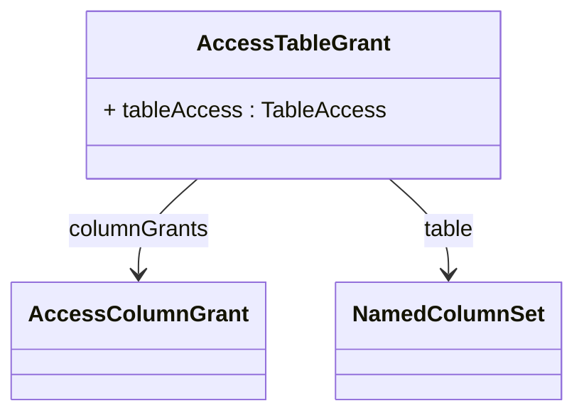

# AccessTableGrant

Package: [model.access.database](./package-model.access.database.md)

Defines table-level security permissions that control access to specific database tables and their columns, providing fine-grained data governance at the physical storage level.

## Attributes

<table>
  <thead>
    <tr>
      <th>Name</th>
      <th>Id</th>
      <th>Type</th>
      <th>Lower</th>
      <th>Upper</th>
      <th>Default</th>
    </tr>
  </thead>
  <tbody>
    <tr>
      <td><strong>tableAccess</strong></td>
      <td>false</td>
      <td><em>TableAccess<a href="./enum-TableAccess">🔗</a></em></td>
      <td>1</td>
      <td>1</td>
      <td></td>
    </tr>
    <tr>
      <td colspan="6"><em>Specifies the access level for the table using TableAccess enumeration values, controlling whether role members can view or modify table data.</em></td>
    </tr>
  </tbody>
</table>

## References

<table>
  <thead>
    <tr>
      <th>Name</th>
      <th>Type</th>
      <th>Lower</th>
      <th>Upper</th>
      <th>Containment</th>
    </tr>
  </thead>
  <tbody>
    <tr>
      <td><strong>columnGrants</strong></td>
      <td>AccessColumnGrant<a href="./class-AccessColumnGrant">🔗</a></td>
      <td>1</td>
      <td>&infin;</td>
      <td>true</td>
    </tr>
    <tr>
      <td colspan="5"><em>Collection of column-level access grants that provide the finest level of security control over individual columns within the table.</em></td>
    </tr>
    <tr>
      <td><strong>table</strong></td>
      <td>NamedColumnSet<a href="./class-NamedColumnSet">🔗</a></td>
      <td>1</td>
      <td>1</td>
      <td>false</td>
    </tr>
    <tr>
      <td colspan="5"><em>References the specific table to which this access grant applies, establishing the security boundary at the table level.</em></td>
    </tr>
  </tbody>
</table>

## Used by

- AccessDatabaseSchemaGrant[🔗](./class-AccessDatabaseSchemaGrant) → tableGrants

## ClassDiagramm

