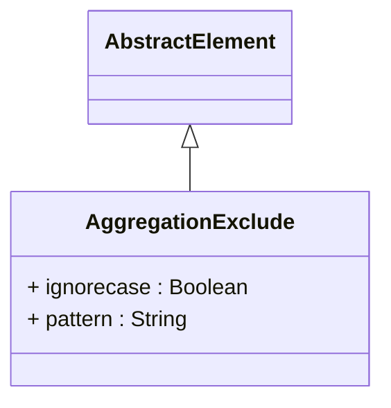

# AggregationExclude

Package: [model.database.aggregation](./package-model.database.aggregation.md)

Defines exclusion rules that prevent specific tables from being used as aggregation tables, even if they would otherwise match aggregation patterns or be considered suitable for aggregation optimization. AggregationExclude is essential for maintaining aggregation accuracy and system reliability by providing explicit control over which tables should be avoided during aggregation table discovery and selection.
## Extends
- AbstractElement [🔗](./class-AbstractElement)

## Attributes

<table>
  <thead>
    <tr>
      <th>Name</th>
      <th>Id</th>
      <th>Type</th>
      <th>Lower</th>
      <th>Upper</th>
      <th>Default</th>
    </tr>
  </thead>
  <tbody>
    <tr>
      <td><strong>ignorecase</strong></td>
      <td>false</td>
      <td><em>Boolean</em></td>
      <td>0</td>
      <td>1</td>
      <td></td>
    </tr>
    <tr>
      <td colspan="6"><em>Boolean flag that controls whether table name matching for this exclusion rule should be case-sensitive or case-insensitive. When set to true, the exclusion matching will ignore case differences, making exclusion rules more robust in environments with inconsistent case usage in table names or when working with databases that have varying case sensitivity behaviors.</em></td>
    </tr>
    <tr>
      <td><strong>pattern</strong></td>
      <td>false</td>
      <td><em>String</em></td>
      <td>0</td>
      <td>1</td>
      <td></td>
    </tr>
    <tr>
      <td colspan="6"><em>Regular expression pattern that defines categories of tables that should be excluded from aggregation table consideration. Pattern-based exclusion enables efficient handling of multiple related tables that share common naming characteristics but should not be used for aggregation purposes. Common exclusion patterns include temporary table prefixes like 'TEMP_.*', backup table suffixes like '.*_BACKUP', or version-specific patterns like '.*_V[0-9]+' for excluding older versions of aggregation tables. The pattern approach is particularly valuable in dynamic environments where problematic tables are created regularly with predictable naming conventions, enabling proactive exclusion without requiring individual configuration for each new table. Pattern matching respects the ignorecase setting for consistent behavior across the exclusion rule.</em></td>
    </tr>
  </tbody>
</table>

## References

<table>
  <thead>
    <tr>
      <th>Name</th>
      <th>Type</th>
      <th>Lower</th>
      <th>Upper</th>
      <th>Containment</th>
    </tr>
  </thead>
  <tbody>
  </tbody>
</table>

## Used by

- PatternAggregationTable[🔗](./class-PatternAggregationTable) → excludes
- TableSource[🔗](./class-TableSource) → aggregationExcludes

## ClassDiagramm

