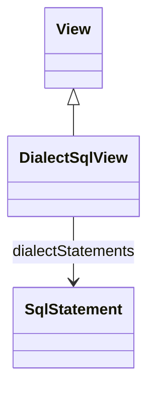

# DialectSqlView

Package: [model.database.relational](./package-model.database.relational.md)

Daanse-specific extension of a CWM View that carries additional dialect-specific SQL statements beyond the standard queryExpression inherited from CWM View. The standard SQL is in View.queryExpression; only deviating dialects need an additional SqlStatement.
## Extends
- View

## Attributes

<table>
  <thead>
    <tr>
      <th>Name</th>
      <th>Id</th>
      <th>Type</th>
      <th>Lower</th>
      <th>Upper</th>
      <th>Default</th>
    </tr>
  </thead>
  <tbody>
  </tbody>
</table>

## References

<table>
  <thead>
    <tr>
      <th>Name</th>
      <th>Type</th>
      <th>Lower</th>
      <th>Upper</th>
      <th>Containment</th>
    </tr>
  </thead>
  <tbody>
    <tr>
      <td><strong>dialectStatements</strong></td>
      <td>SqlStatement<a href="./class-SqlStatement">🔗</a></td>
      <td>0</td>
      <td>&infin;</td>
      <td>true</td>
    </tr>
    <tr>
      <td colspan="5"><em>Per-dialect SQL overrides. Empty means the View.queryExpression applies to all dialects.</em></td>
    </tr>
  </tbody>
</table>

## Used by

- SqlSelectSource[🔗](./class-SqlSelectSource) → sql

## ClassDiagramm

