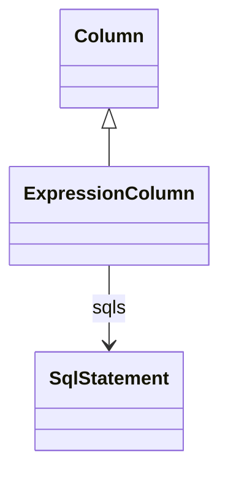

# ExpressionColumn

Package: [model.database.relational](./package-model.database.relational.md)

Daanse-specific extension of a CWM relational Column that is not backed by a physical column but by one or more SQL expressions (optionally per database dialect). We recommend using the column name together with the table name in SQL expressions.
## Extends
- Column [🔗](./class-Column)

## Attributes

<table>
  <thead>
    <tr>
      <th>Name</th>
      <th>Id</th>
      <th>Type</th>
      <th>Lower</th>
      <th>Upper</th>
      <th>Default</th>
    </tr>
  </thead>
  <tbody>
  </tbody>
</table>

## References

<table>
  <thead>
    <tr>
      <th>Name</th>
      <th>Type</th>
      <th>Lower</th>
      <th>Upper</th>
      <th>Containment</th>
    </tr>
  </thead>
  <tbody>
    <tr>
      <td><strong>sqls</strong></td>
      <td>SqlStatement<a href="./class-SqlStatement">🔗</a></td>
      <td>1</td>
      <td>&infin;</td>
      <td>true</td>
    </tr>
    <tr>
      <td colspan="5"><em>SQL expressions defining the column value. Per-dialect entries supported.</em></td>
    </tr>
  </tbody>
</table>

## Used by

- SQLExpressionBaseMeasure[🔗](./class-SQLExpressionBaseMeasure) → column

## ClassDiagramm

