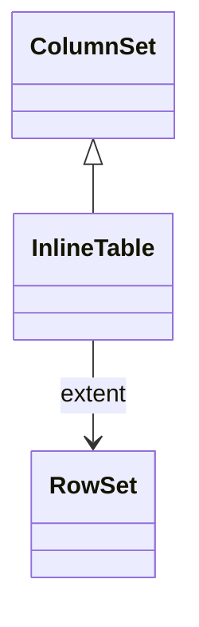

# InlineTable

Package: [model.database.relational](./package-model.database.relational.md)

Daanse-specific CWM ColumnSet extension that carries its data inline as Rows rather than referencing external persisted data. Unlike cwm::Table it is not a DB-schema element (no persistence, triggers, temporary-scope or SQL-structured-type semantics apply). It is a peer of cwm::QueryColumnSet: both sit under ColumnSet as non-persistent named column sets. Typically used for small lookup tables or test fixtures.
## Extends
- ColumnSet [🔗](./class-ColumnSet)

## Attributes

<table>
  <thead>
    <tr>
      <th>Name</th>
      <th>Id</th>
      <th>Type</th>
      <th>Lower</th>
      <th>Upper</th>
      <th>Default</th>
    </tr>
  </thead>
  <tbody>
  </tbody>
</table>

## References

<table>
  <thead>
    <tr>
      <th>Name</th>
      <th>Type</th>
      <th>Lower</th>
      <th>Upper</th>
      <th>Containment</th>
    </tr>
  </thead>
  <tbody>
    <tr>
      <td><strong>extent</strong></td>
      <td>RowSet<a href="./class-RowSet">🔗</a></td>
      <td>0</td>
      <td>1</td>
      <td>true</td>
    </tr>
    <tr>
      <td colspan="5"><em>Inline data for this table, modeled as a CWM RowSet (Extent of Row instances). Each Row carries DataSlots that bind a Column to a literal data value.</em></td>
    </tr>
  </tbody>
</table>

## Used by

- InlineTableSource[🔗](./class-InlineTableSource) → table

## ClassDiagramm

