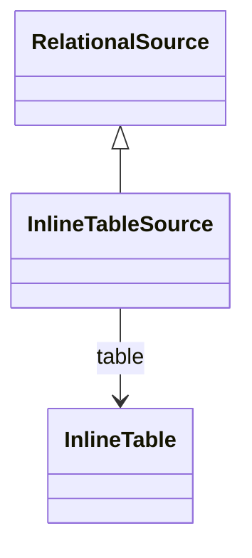

# InlineTableSource

Package: [model.database.source](./package-model.database.source.md)

Inline-table data as a source. References a Daanse InlineTable which carries the Rows.
## Extends
- RelationalSource [🔗](./class-RelationalSource)

## Attributes

<table>
  <thead>
    <tr>
      <th>Name</th>
      <th>Id</th>
      <th>Type</th>
      <th>Lower</th>
      <th>Upper</th>
      <th>Default</th>
    </tr>
  </thead>
  <tbody>
  </tbody>
</table>

## References

<table>
  <thead>
    <tr>
      <th>Name</th>
      <th>Type</th>
      <th>Lower</th>
      <th>Upper</th>
      <th>Containment</th>
    </tr>
  </thead>
  <tbody>
    <tr>
      <td><strong>table</strong></td>
      <td>InlineTable<a href="./class-InlineTable">🔗</a></td>
      <td>1</td>
      <td>1</td>
      <td>true</td>
    </tr>
    <tr>
      <td colspan="5"><em>The inline table.</em></td>
    </tr>
  </tbody>
</table>

## Used by

## ClassDiagramm

