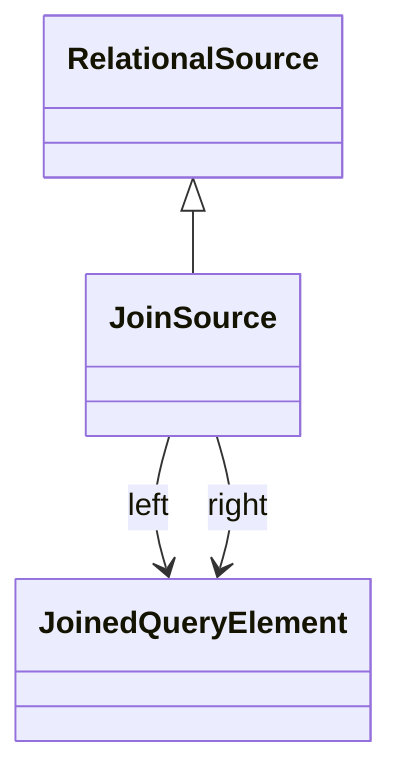

# JoinSource

Package: [model.database.source](./package-model.database.source.md)

Join of two sub-sources, linking them via a left/right JoinedQueryElement pair.
## Extends
- RelationalSource [🔗](./class-RelationalSource)

## Attributes

<table>
  <thead>
    <tr>
      <th>Name</th>
      <th>Id</th>
      <th>Type</th>
      <th>Lower</th>
      <th>Upper</th>
      <th>Default</th>
    </tr>
  </thead>
  <tbody>
  </tbody>
</table>

## References

<table>
  <thead>
    <tr>
      <th>Name</th>
      <th>Type</th>
      <th>Lower</th>
      <th>Upper</th>
      <th>Containment</th>
    </tr>
  </thead>
  <tbody>
    <tr>
      <td><strong>left</strong></td>
      <td>JoinedQueryElement<a href="./class-JoinedQueryElement">🔗</a></td>
      <td>1</td>
      <td>1</td>
      <td>true</td>
    </tr>
    <tr>
      <td colspan="5"><em>Left side of the join.</em></td>
    </tr>
    <tr>
      <td><strong>right</strong></td>
      <td>JoinedQueryElement<a href="./class-JoinedQueryElement">🔗</a></td>
      <td>1</td>
      <td>1</td>
      <td>true</td>
    </tr>
    <tr>
      <td colspan="5"><em>Right side of the join.</em></td>
    </tr>
  </tbody>
</table>

## Used by

## ClassDiagramm

