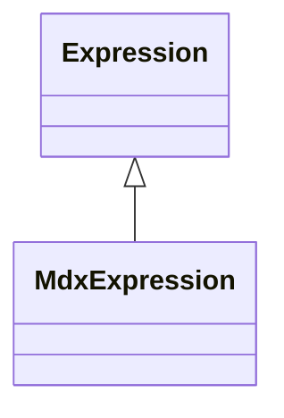

# MdxExpression

Package: [model](./index.md)

An MDX expression, carried in the inherited CWM Expression.body. The class itself is the language marker (mirroring CWM's QueryExpression/ProcedureExpression marker subclasses); the inherited language attribute may name the language explicitly but the type is authoritative. Used for named-set and calculated-member formulas, KPI expressions and calculated member property expressions.
## Extends
- Expression [🔗](./class-Expression)

## Attributes

<table>
  <thead>
    <tr>
      <th>Name</th>
      <th>Id</th>
      <th>Type</th>
      <th>Lower</th>
      <th>Upper</th>
      <th>Default</th>
    </tr>
  </thead>
  <tbody>
  </tbody>
</table>

## References

<table>
  <thead>
    <tr>
      <th>Name</th>
      <th>Type</th>
      <th>Lower</th>
      <th>Upper</th>
      <th>Containment</th>
    </tr>
  </thead>
  <tbody>
  </tbody>
</table>

## Used by

- AccessMemberGrant[🔗](./class-AccessMemberGrant) → member
- Kpi[🔗](./class-Kpi) → value
- Kpi[🔗](./class-Kpi) → goal
- Kpi[🔗](./class-Kpi) → status
- Kpi[🔗](./class-Kpi) → trend
- Kpi[🔗](./class-Kpi) → currentTimeMember
- NamedSet[🔗](./class-NamedSet) → formula
- CalculatedMember[🔗](./class-CalculatedMember) → formula
- CalculatedMemberProperty[🔗](./class-CalculatedMemberProperty) → expression

## ClassDiagramm

