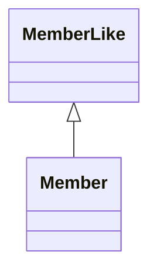

# Member

Package: [model.olap.dimension.hierarchy.level](./package-model.olap.dimension.hierarchy.level.md)

Abstract base class representing a member in the OLAP multidimensional model. A Member is a specific point or value within a dimension that can be used for slicing, dicing, and filtering data in analytical queries. Members exist within hierarchies and levels, forming the navigational structure that users traverse when exploring data. Examples include [Time].[1997].[January], [Customer].[USA].[California], or [Measures].[Sales Amount]. Members can have parent-child relationships, properties, and various types including regular dimensional values, calculated formulas, or special system members like All members. This abstract class provides the foundation for both regular dimension members and measures, which are special members of the [Measures] dimension.
## Extends
- MemberLike [🔗](./class-MemberLike)

## Attributes

<table>
  <thead>
    <tr>
      <th>Name</th>
      <th>Id</th>
      <th>Type</th>
      <th>Lower</th>
      <th>Upper</th>
      <th>Default</th>
    </tr>
  </thead>
  <tbody>
  </tbody>
</table>

## References

<table>
  <thead>
    <tr>
      <th>Name</th>
      <th>Type</th>
      <th>Lower</th>
      <th>Upper</th>
      <th>Containment</th>
    </tr>
  </thead>
  <tbody>
  </tbody>
</table>

## Used by

## ClassDiagramm

