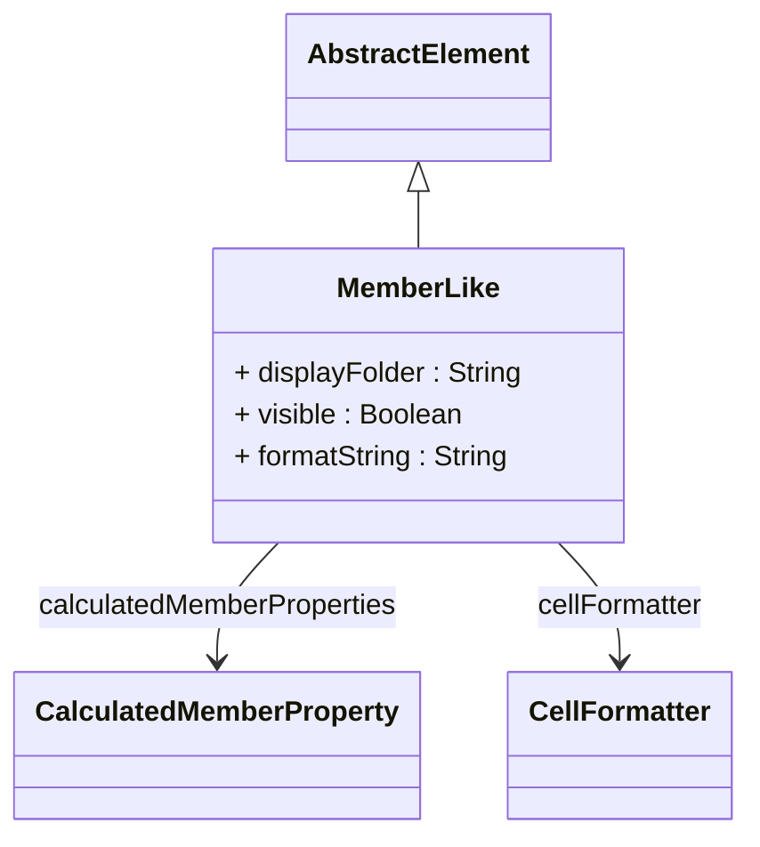

# MemberLike

Package: [model.olap.dimension.hierarchy.level](./package-model.olap.dimension.hierarchy.level.md)

Common abstraction for everything that behaves like a member in client tools: dimension members and measures alike carry visibility, a display folder, a format string, a cell formatter and calculated member properties. Measures are not members of a dimension hierarchy — BaseMeasure therefore inherits from this class, not from Member (a measure pretending to be a hierarchy member was a false CWM statement); Member adds the hierarchy semantics on top.
## Extends
- AbstractElement [🔗](./class-AbstractElement)

## Attributes

<table>
  <thead>
    <tr>
      <th>Name</th>
      <th>Id</th>
      <th>Type</th>
      <th>Lower</th>
      <th>Upper</th>
      <th>Default</th>
    </tr>
  </thead>
  <tbody>
    <tr>
      <td><strong>displayFolder</strong></td>
      <td>false</td>
      <td><em>String</em></td>
      <td>0</td>
      <td>1</td>
      <td></td>
    </tr>
    <tr>
      <td colspan="6"><em>Optional folder path that organizes this member within client tool hierarchies and measure lists. Display folders create logical groupings in OLAP client interfaces, helping users navigate large numbers of measures and calculated members. For example, 'Financial\\Profitability' or 'Operations\\Quality Metrics'. The folder structure appears in tools like Excel pivot tables and cube browsers. A deliberate typed attribute per class carrying the neutral folder path: real client metadata deserves a typed feature, so it is neither pulled up to AbstractElement nor degraded to a tagged value.</em></td>
    </tr>
    <tr>
      <td><strong>visible</strong></td>
      <td>false</td>
      <td><em>Boolean</em></td>
      <td>0</td>
      <td>1</td>
      <td>true</td>
    </tr>
    <tr>
      <td colspan="6"><em>Boolean flag controlling whether this member appears in client tool member lists, XMLA metadata discovery, and cube browsers. When set to false, the member becomes hidden from normal user interfaces but remains accessible through direct references in MDX queries. This is useful for creating internal system members, intermediate calculation steps, or advanced members intended only for power users who know the member names explicitly. Deliberately distinct from the inherited CWM ModelElement.visibility, which carries namespace access semantics: visible is a client display hint only, and invisible elements stay fully addressable in MDX. The attribute stays declared per class instead of moving to AbstractElement, where it would bleed onto Catalog, AccessRole and friends.</em></td>
    </tr>
    <tr>
      <td><strong>formatString</strong></td>
      <td>false</td>
      <td><em>String</em></td>
      <td>0</td>
      <td>1</td>
      <td></td>
    </tr>
    <tr>
      <td colspan="6"><em>Format string that defines how values for this member should be displayed in client applications. Uses standard formatting syntax for numbers, currencies, dates, and percentages (e.g., '#,##0.00', '$#,##0', 'yyyy-MM-dd', '0.0%'). This formatting is applied consistently across all OLAP clients and XMLA-compliant tools, ensuring uniform data presentation regardless of the client application being used.</em></td>
    </tr>
  </tbody>
</table>

## References

<table>
  <thead>
    <tr>
      <th>Name</th>
      <th>Type</th>
      <th>Lower</th>
      <th>Upper</th>
      <th>Containment</th>
    </tr>
  </thead>
  <tbody>
    <tr>
      <td><strong>calculatedMemberProperties</strong></td>
      <td>CalculatedMemberProperty<a href="./class-CalculatedMemberProperty">🔗</a></td>
      <td>0</td>
      <td>&infin;</td>
      <td>true</td>
    </tr>
    <tr>
      <td colspan="5"><em>Collection of calculated member properties that provide additional metadata and computed values for this member. These properties extend the member with custom attributes that can be derived through MDX expressions, such as formatted display names, conditional formatting rules, or business logic calculations. Calculated member properties are particularly useful for measures and calculated members where dynamic property values enhance the analytical experience.</em></td>
    </tr>
    <tr>
      <td><strong>cellFormatter</strong></td>
      <td>CellFormatter<a href="./class-CellFormatter">🔗</a></td>
      <td>0</td>
      <td>1</td>
      <td>false</td>
    </tr>
    <tr>
      <td colspan="5"><em>Reference to a cell formatter that controls how values associated with this member are displayed in client applications. The formatter defines number formatting, currency symbols, date formats, and other presentation rules that ensure consistent and appropriate display of this member's data across different analytical tools and reports.</em></td>
    </tr>
  </tbody>
</table>

## Used by

- Cube[🔗](./class-Cube) → defaultMeasure

## ClassDiagramm

