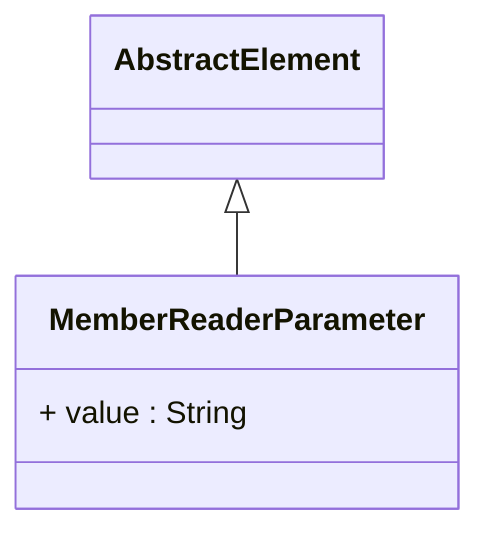

# MemberReaderParameter

Package: [model.olap.dimension.hierarchy.level](./package-model.olap.dimension.hierarchy.level.md)

Defines configuration parameters that are passed to custom MemberReader implementations to control specialized member loading behavior, caching strategies, performance optimization, and integration with external data sources or business logic systems. MemberReaderParameter represents a flexible configuration mechanism that enables sophisticated customization of how dimensional members are loaded, cached, and presented within OLAP hierarchies, supporting advanced scenarios where standard member loading approaches are insufficient for complex business requirements, performance constraints, or integration needs.
## Extends
- AbstractElement [🔗](./class-AbstractElement)

## Attributes

<table>
  <thead>
    <tr>
      <th>Name</th>
      <th>Id</th>
      <th>Type</th>
      <th>Lower</th>
      <th>Upper</th>
      <th>Default</th>
    </tr>
  </thead>
  <tbody>
    <tr>
      <td><strong>value</strong></td>
      <td>false</td>
      <td><em>String</em></td>
      <td>1</td>
      <td>1</td>
      <td></td>
    </tr>
    <tr>
      <td colspan="6"><em>Parameter value that provides the specific configuration setting or data that the MemberReader implementation will use to customize its behavior. The value format and interpretation depends on the parameter name and the MemberReader implementation, enabling flexible configuration that can include numeric settings, string values, connection strings, file paths, or complex configuration expressions.</em></td>
    </tr>
  </tbody>
</table>

## References

<table>
  <thead>
    <tr>
      <th>Name</th>
      <th>Type</th>
      <th>Lower</th>
      <th>Upper</th>
      <th>Containment</th>
    </tr>
  </thead>
  <tbody>
  </tbody>
</table>

## Used by

- Hierarchy[🔗](./class-Hierarchy) → memberReaderParameters

## ClassDiagramm

