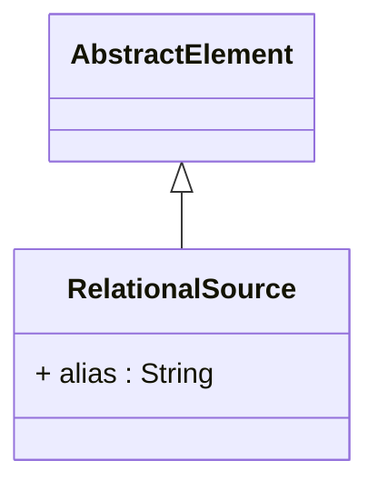

# RelationalSource

Package: [model.database.source](./package-model.database.source.md)

Abstract base for a data source used by a cube or hierarchy. Replaces the previous Query/RelationalQuery hierarchy. Concrete sub-types point at a CWM NamedColumnSet (table/view), an inline SQL select, a join, or an inline table.
## Extends
- AbstractElement [🔗](./class-AbstractElement)

## Attributes

<table>
  <thead>
    <tr>
      <th>Name</th>
      <th>Id</th>
      <th>Type</th>
      <th>Lower</th>
      <th>Upper</th>
      <th>Default</th>
    </tr>
  </thead>
  <tbody>
    <tr>
      <td><strong>alias</strong></td>
      <td>false</td>
      <td><em>String</em></td>
      <td>0</td>
      <td>1</td>
      <td></td>
    </tr>
    <tr>
      <td colspan="6"><em>Optional SQL table alias used when this source participates in joins or SQL generation.</em></td>
    </tr>
  </tbody>
</table>

## References

<table>
  <thead>
    <tr>
      <th>Name</th>
      <th>Type</th>
      <th>Lower</th>
      <th>Upper</th>
      <th>Containment</th>
    </tr>
  </thead>
  <tbody>
  </tbody>
</table>

## Used by

- JoinedQueryElement[🔗](./class-JoinedQueryElement) → source
- PhysicalCube[🔗](./class-PhysicalCube) → source
- Hierarchy[🔗](./class-Hierarchy) → source
- Level[🔗](./class-Level) → relationalSource

## ClassDiagramm

