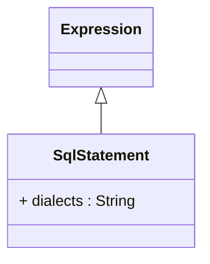

# SqlStatement

Package: [model.database.source](./package-model.database.source.md)

Contains SQL expression text and database dialect information for database-specific SQL implementations. SqlStatement enables OLAP schemas to support multiple database platforms by providing dialect-specific SQL expressions.
## Extends
- Expression

## Attributes

<table>
  <thead>
    <tr>
      <th>Name</th>
      <th>Id</th>
      <th>Type</th>
      <th>Lower</th>
      <th>Upper</th>
      <th>Default</th>
    </tr>
  </thead>
  <tbody>
    <tr>
      <td><strong>dialects</strong></td>
      <td>false</td>
      <td><em>String</em></td>
      <td>0</td>
      <td>&infin;</td>
      <td></td>
    </tr>
    <tr>
      <td colspan="6"><em>Collection of database dialect identifiers that specify which database systems this SQL statement applies to. Examples include 'mysql', 'postgresql', 'oracle', 'sqlserver'. When empty, the statement applies to all database types.</em></td>
    </tr>
  </tbody>
</table>

## References

<table>
  <thead>
    <tr>
      <th>Name</th>
      <th>Type</th>
      <th>Lower</th>
      <th>Upper</th>
      <th>Containment</th>
    </tr>
  </thead>
  <tbody>
  </tbody>
</table>

## Used by

- ExpressionColumn[🔗](./class-ExpressionColumn) → sqls
- DialectSqlView[🔗](./class-DialectSqlView) → dialectStatements
- TableSource[🔗](./class-TableSource) → sqlWhereExpression

## ClassDiagramm

