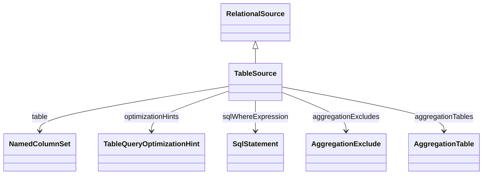

# TableSource

Package: [model.database.source](./package-model.database.source.md)

References a CWM NamedColumnSet (Table or View) as the data source. May carry optimization hints, an optional SQL WHERE pre-filter, aggregation-table references and aggregation-exclude rules.
## Extends
- RelationalSource [🔗](./class-RelationalSource)

## Attributes

<table>
  <thead>
    <tr>
      <th>Name</th>
      <th>Id</th>
      <th>Type</th>
      <th>Lower</th>
      <th>Upper</th>
      <th>Default</th>
    </tr>
  </thead>
  <tbody>
  </tbody>
</table>

## References

<table>
  <thead>
    <tr>
      <th>Name</th>
      <th>Type</th>
      <th>Lower</th>
      <th>Upper</th>
      <th>Containment</th>
    </tr>
  </thead>
  <tbody>
    <tr>
      <td><strong>table</strong></td>
      <td>NamedColumnSet<a href="./class-NamedColumnSet">🔗</a></td>
      <td>1</td>
      <td>1</td>
      <td>false</td>
    </tr>
    <tr>
      <td colspan="5"><em>The backing CWM table or view.</em></td>
    </tr>
    <tr>
      <td><strong>optimizationHints</strong></td>
      <td>TableQueryOptimizationHint<a href="./class-TableQueryOptimizationHint">🔗</a></td>
      <td>0</td>
      <td>&infin;</td>
      <td>true</td>
    </tr>
    <tr>
      <td colspan="5"><em>Optional optimization hints (e.g. index-usage, access-plan overrides).</em></td>
    </tr>
    <tr>
      <td><strong>sqlWhereExpression</strong></td>
      <td>SqlStatement<a href="./class-SqlStatement">🔗</a></td>
      <td>0</td>
      <td>1</td>
      <td>true</td>
    </tr>
    <tr>
      <td colspan="5"><em>Optional SQL WHERE clause expression that filters the table data before processing by the OLAP engine.</em></td>
    </tr>
    <tr>
      <td><strong>aggregationExcludes</strong></td>
      <td>AggregationExclude<a href="./class-AggregationExclude">🔗</a></td>
      <td>0</td>
      <td>&infin;</td>
      <td>true</td>
    </tr>
    <tr>
      <td colspan="5"><em>Rules that specify when aggregation tables must not be used for this source.</em></td>
    </tr>
    <tr>
      <td><strong>aggregationTables</strong></td>
      <td>AggregationTable<a href="./class-AggregationTable">🔗</a></td>
      <td>0</td>
      <td>&infin;</td>
      <td>true</td>
    </tr>
    <tr>
      <td colspan="5"><em>Pre-computed aggregation tables available to accelerate queries against this source.</em></td>
    </tr>
  </tbody>
</table>

## Used by

- ParentChildLink[🔗](./class-ParentChildLink) → table

## ClassDiagramm

