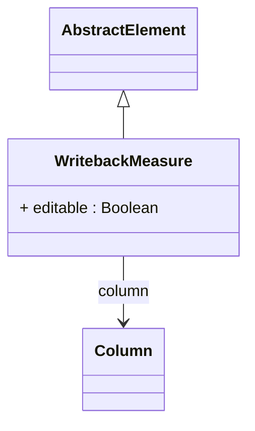

# WritebackMeasure

Package: [model.olap.cube.measure](./package-model.olap.cube.measure.md)

Defines a measure that participates in writeback operations, enabling sophisticated collaborative planning, budgeting, forecasting, and analytical data modification scenarios where business users can directly update measure values through OLAP client applications and have those changes automatically persisted to designated database tables. Conceptually a measure (lives in the olap.cube.measure package); paired with a database Column that stores the modified value.
## Extends
- AbstractElement [🔗](./class-AbstractElement)

## Attributes

<table>
  <thead>
    <tr>
      <th>Name</th>
      <th>Id</th>
      <th>Type</th>
      <th>Lower</th>
      <th>Upper</th>
      <th>Default</th>
    </tr>
  </thead>
  <tbody>
    <tr>
      <td><strong>editable</strong></td>
      <td>false</td>
      <td><em>Boolean</em></td>
      <td>1</td>
      <td>1</td>
      <td>true</td>
    </tr>
    <tr>
      <td colspan="6"><em>true if writeback measure is editable</em></td>
    </tr>
  </tbody>
</table>

## References

<table>
  <thead>
    <tr>
      <th>Name</th>
      <th>Type</th>
      <th>Lower</th>
      <th>Upper</th>
      <th>Containment</th>
    </tr>
  </thead>
  <tbody>
    <tr>
      <td><strong>column</strong></td>
      <td>Column<a href="./class-Column">🔗</a></td>
      <td>1</td>
      <td>1</td>
      <td>false</td>
    </tr>
    <tr>
      <td colspan="5"><em>Required reference to the database Column that stores the measure values that can be modified through writeback operations, establishing the physical data storage location where updated measure values will be persisted when users perform analytical data modifications.</em></td>
    </tr>
  </tbody>
</table>

## Used by

- WritebackTable[🔗](./class-WritebackTable) → writebackMeasure

## ClassDiagramm

