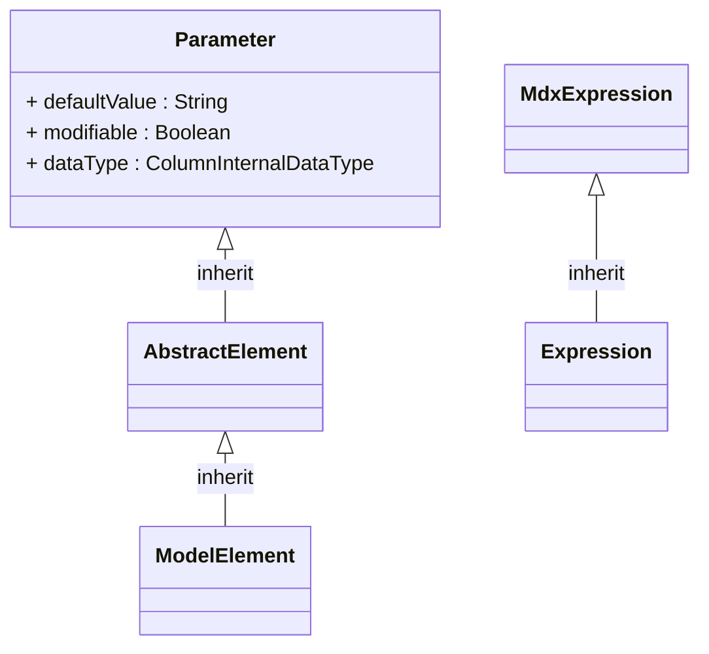

# 🧩 Introduction: Model Structure and Class Overview

This chapter provides a comprehensive overview of all classes and enumerations defined in the EMF Ecore model. Each section focuses on a single class or enum, presenting its full structure, including:

- Attributes and their types
- References to other model elements
- Cardinalities, Containsments and default values
- Usage relationships across the model
- A visual diagram for better understanding

The documentation is generated directly from the Ecore/XMI representation of the model, ensuring consistency with the underlying formal definition.

Unlike formats such as JSON or YAML, XMI is a model-oriented serialization designed for structural clarity and type safety. It captures the semantics and relationships of your model elements explicitly, making it the preferred format for precise and scalable domain modeling.

Use this section to explore how the individual elements of your model are defined and how they interconnect — both structurally and semantically.

## Package: model
URI: `https://www.daanse.org/spec/org.eclipse.daanse.rolap.mapping`
Prefix: `roma`

Eclipse Daanse ROLAP Mapping EMF Package - Enterprise-grade metamodel framework for defining comprehensive multidimensional analytical schemas, OLAP cube architectures, and sophisticated business intelligence data structures in Relational OLAP (ROLAP) systems. This EMF-based modeling framework represents the culmination of decades of OLAP research and enterprise deployment experience, providing a complete type system that seamlessly bridges the conceptual gap between traditional relational database structures and advanced multidimensional analytical paradigms required for modern business intelligence applications. Supports database schema modeling, multidimensional cube architectures, hierarchical dimensional modeling, advanced measure calculations, comprehensive security frameworks, aggregation optimization, writeback capabilities, cross-database compatibility, SQL integration, KPI management, and enterprise deployment patterns.

### Subpackages

- [Package model.access](./package-model.access.md)
- [Package model.catalog](./package-model.catalog.md)
- [Package model.database](./package-model.database.md)
- [Package model.olap](./package-model.olap.md)

## PackageDiagram

A full overview of the package is given in the following diagram. It shows all classes and enums, their attributes and references. In the Pages of the Classes are diagrams with the Focus on the Class itself and only the related Classes.

<ClientOnly>
<MermaidZoom>

</MermaidZoom>
</ClientOnly>

### All Classes and Enums

- [Class AbstractElement](./class-AbstractElement.md)
- [Class MdxExpression](./class-MdxExpression.md)
- [Class Parameter](./class-Parameter.md)

