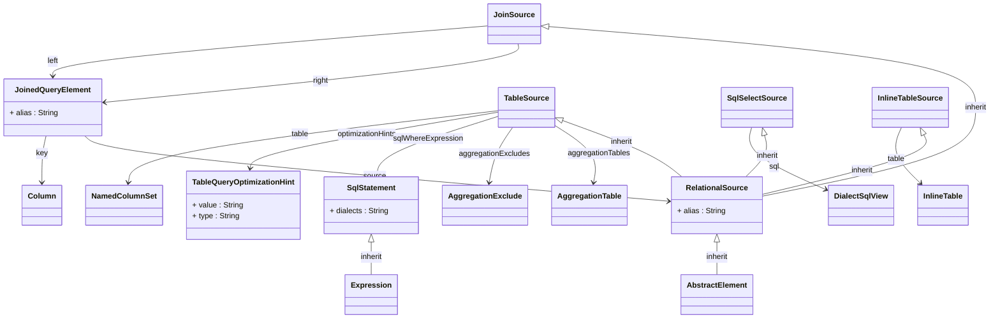

## Package: model.database.source
URI: `https://www.daanse.org/spec/org.eclipse.daanse.rolap.mapping/database/source`
Prefix: `rolapsrc`

Relational source types used as data sources for cubes and hierarchies.

Parent package: [model.database](./package-model.database.md)

## PackageDiagram

A full overview of the package is given in the following diagram. It shows all classes and enums, their attributes and references. In the Pages of the Classes are diagrams with the Focus on the Class itself and only the related Classes.

<ClientOnly>
<MermaidZoom>

</MermaidZoom>
</ClientOnly>

### All Classes and Enums

- [Class JoinedQueryElement](./class-JoinedQueryElement.md)
- [Class RelationalSource](./class-RelationalSource.md)
- [Class TableSource](./class-TableSource.md)
- [Class SqlSelectSource](./class-SqlSelectSource.md)
- [Class JoinSource](./class-JoinSource.md)
- [Class InlineTableSource](./class-InlineTableSource.md)
- [Class SqlStatement](./class-SqlStatement.md)
- [Class TableQueryOptimizationHint](./class-TableQueryOptimizationHint.md)

