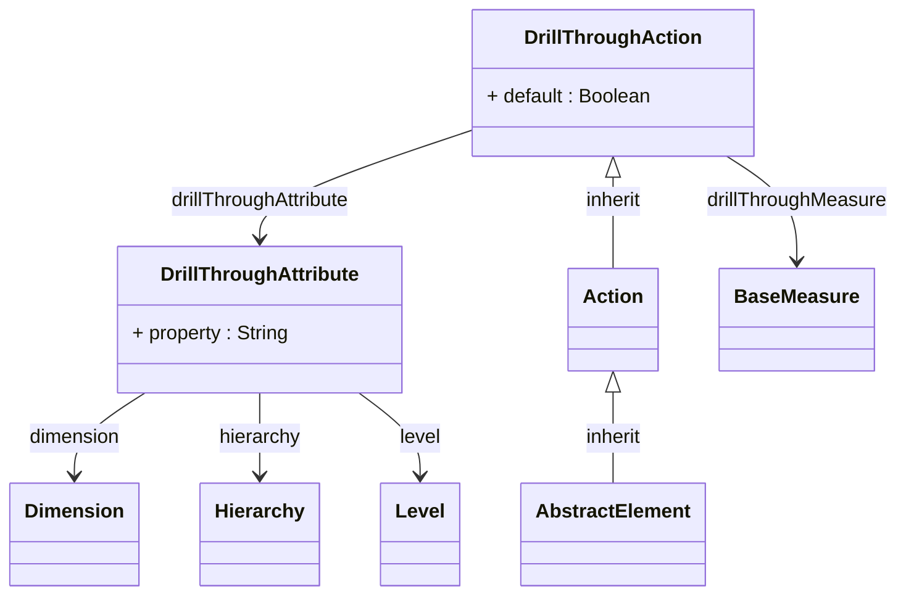

## Package: model.olap.cube.action
URI: `https://www.daanse.org/spec/org.eclipse.daanse.rolap.mapping/olap/cube/action`
Prefix: `rolapact`

Cube actions (drill-through, attributes).

Parent package: [model.olap.cube](./package-model.olap.cube.md)

## PackageDiagram

A full overview of the package is given in the following diagram. It shows all classes and enums, their attributes and references. In the Pages of the Classes are diagrams with the Focus on the Class itself and only the related Classes.

<ClientOnly>
<MermaidZoom>

</MermaidZoom>
</ClientOnly>

### All Classes and Enums

- [Class Action](./class-Action.md)
- [Class DrillThroughAction](./class-DrillThroughAction.md)
- [Class DrillThroughAttribute](./class-DrillThroughAttribute.md)

