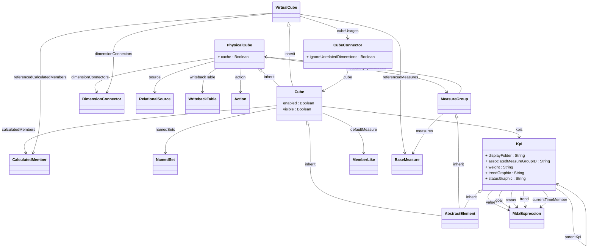

## Package: model.olap.cube
URI: `https://www.daanse.org/spec/org.eclipse.daanse.rolap.mapping/olap/cube`
Prefix: `rolapcube`

Cube types with direct cube-scoped attachments.

Parent package: [model.olap](./package-model.olap.md)

### Subpackages

- [Package model.olap.cube.action](./package-model.olap.cube.action.md)
- [Package model.olap.cube.measure](./package-model.olap.cube.measure.md)

## PackageDiagram

A full overview of the package is given in the following diagram. It shows all classes and enums, their attributes and references. In the Pages of the Classes are diagrams with the Focus on the Class itself and only the related Classes.

<ClientOnly>
<MermaidZoom>

</MermaidZoom>
</ClientOnly>

### All Classes and Enums

- [Class Cube](./class-Cube.md)
- [Class PhysicalCube](./class-PhysicalCube.md)
- [Class VirtualCube](./class-VirtualCube.md)
- [Class CubeConnector](./class-CubeConnector.md)
- [Class MeasureGroup](./class-MeasureGroup.md)
- [Class Kpi](./class-Kpi.md)

