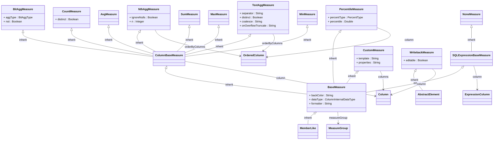

## Package: model.olap.cube.measure
URI: `https://www.daanse.org/spec/org.eclipse.daanse.rolap.mapping/olap/cube/measure`
Prefix: `rolapmeas`

Base measure abstraction and concrete aggregator variants.

Parent package: [model.olap.cube](./package-model.olap.cube.md)

## PackageDiagram

A full overview of the package is given in the following diagram. It shows all classes and enums, their attributes and references. In the Pages of the Classes are diagrams with the Focus on the Class itself and only the related Classes.

<ClientOnly>
<MermaidZoom>

</MermaidZoom>
</ClientOnly>

### All Classes and Enums

- [Class MinMeasure](./class-MinMeasure.md)
- [Class MaxMeasure](./class-MaxMeasure.md)
- [Class SumMeasure](./class-SumMeasure.md)
- [Class AvgMeasure](./class-AvgMeasure.md)
- [Class NoneMeasure](./class-NoneMeasure.md)
- [Class CountMeasure](./class-CountMeasure.md)
- [Class TextAggMeasure](./class-TextAggMeasure.md)
- [Class BitAggMeasure](./class-BitAggMeasure.md)
- [Class PercentileMeasure](./class-PercentileMeasure.md)
- [Class NthAggMeasure](./class-NthAggMeasure.md)
- [Class CustomMeasure](./class-CustomMeasure.md)
- [Class SQLExpressionBaseMeasure](./class-SQLExpressionBaseMeasure.md)
- [Class ColumnBaseMeasure](./class-ColumnBaseMeasure.md)
- [Class BaseMeasure](./class-BaseMeasure.md)
- [Class WritebackMeasure](./class-WritebackMeasure.md)

- [Enum BitAggType](./enum-BitAggType.md)
- [Enum PercentType](./enum-PercentType.md)

