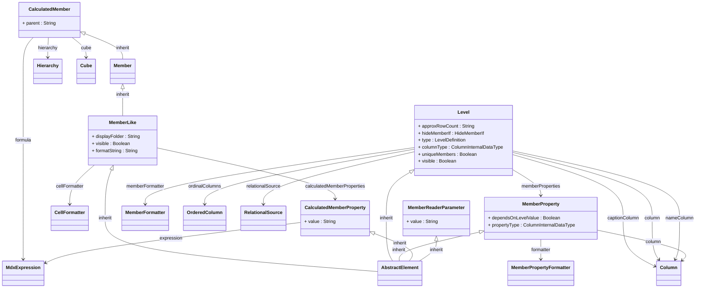

## Package: model.olap.dimension.hierarchy.level
URI: `https://www.daanse.org/spec/org.eclipse.daanse.rolap.mapping/olap/dimension/hierarchy/level`
Prefix: `rolaplev`

Level, Member, MemberProperty and their calculated variants.

Parent package: [model.olap.dimension.hierarchy](./package-model.olap.dimension.hierarchy.md)

## PackageDiagram

A full overview of the package is given in the following diagram. It shows all classes and enums, their attributes and references. In the Pages of the Classes are diagrams with the Focus on the Class itself and only the related Classes.

<ClientOnly>
<MermaidZoom>

</MermaidZoom>
</ClientOnly>

### All Classes and Enums

- [Class MemberLike](./class-MemberLike.md)
- [Class Member](./class-Member.md)
- [Class Level](./class-Level.md)
- [Class MemberProperty](./class-MemberProperty.md)
- [Class CalculatedMember](./class-CalculatedMember.md)
- [Class CalculatedMemberProperty](./class-CalculatedMemberProperty.md)
- [Class MemberReaderParameter](./class-MemberReaderParameter.md)

- [Enum HideMemberIf](./enum-HideMemberIf.md)
- [Enum LevelDefinition](./enum-LevelDefinition.md)

