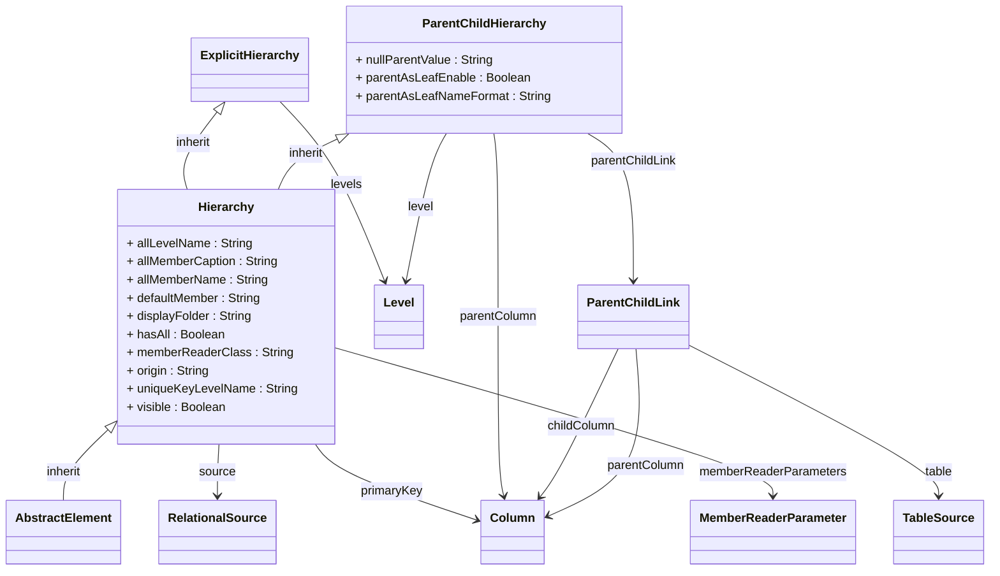

## Package: model.olap.dimension.hierarchy
URI: `https://www.daanse.org/spec/org.eclipse.daanse.rolap.mapping/olap/dimension/hierarchy`
Prefix: `rolaphier`

Hierarchy types (explicit, parent-child) and parent-child link.

Parent package: [model.olap.dimension](./package-model.olap.dimension.md)

### Subpackages

- [Package model.olap.dimension.hierarchy.level](./package-model.olap.dimension.hierarchy.level.md)

## PackageDiagram

A full overview of the package is given in the following diagram. It shows all classes and enums, their attributes and references. In the Pages of the Classes are diagrams with the Focus on the Class itself and only the related Classes.

<ClientOnly>
<MermaidZoom>

</MermaidZoom>
</ClientOnly>

### All Classes and Enums

- [Class Hierarchy](./class-Hierarchy.md)
- [Class ExplicitHierarchy](./class-ExplicitHierarchy.md)
- [Class ParentChildHierarchy](./class-ParentChildHierarchy.md)
- [Class ParentChildLink](./class-ParentChildLink.md)

- [Enum RollupPolicy](./enum-RollupPolicy.md)

