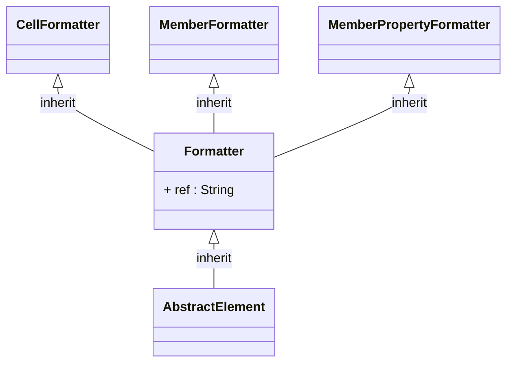

## Package: model.olap.format
URI: `https://www.daanse.org/spec/org.eclipse.daanse.rolap.mapping/olap/format`
Prefix: `rolapfmt`

Formatters for cell values, members and member properties.

Parent package: [model.olap](./package-model.olap.md)

## PackageDiagram

A full overview of the package is given in the following diagram. It shows all classes and enums, their attributes and references. In the Pages of the Classes are diagrams with the Focus on the Class itself and only the related Classes.

<ClientOnly>
<MermaidZoom>

</MermaidZoom>
</ClientOnly>

### All Classes and Enums

- [Class Formatter](./class-Formatter.md)
- [Class CellFormatter](./class-CellFormatter.md)
- [Class MemberFormatter](./class-MemberFormatter.md)
- [Class MemberPropertyFormatter](./class-MemberPropertyFormatter.md)

